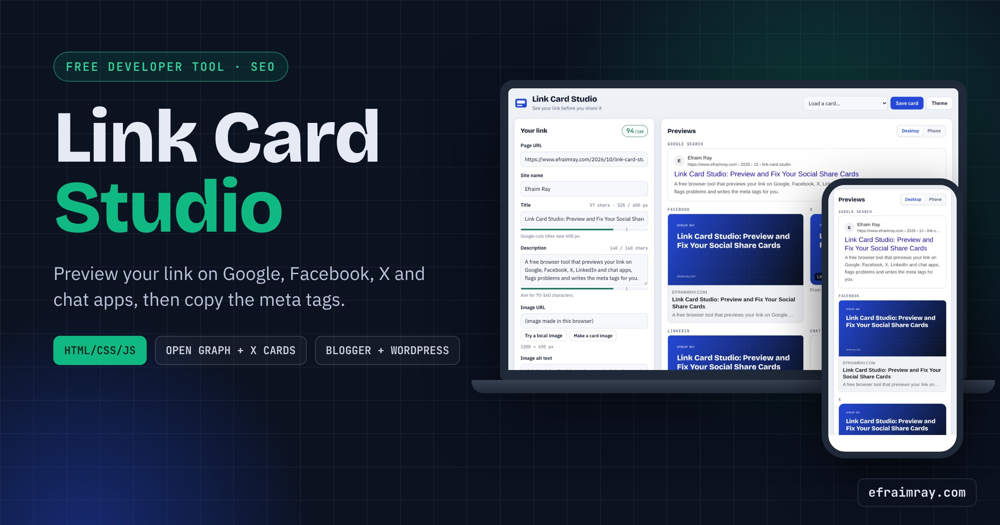
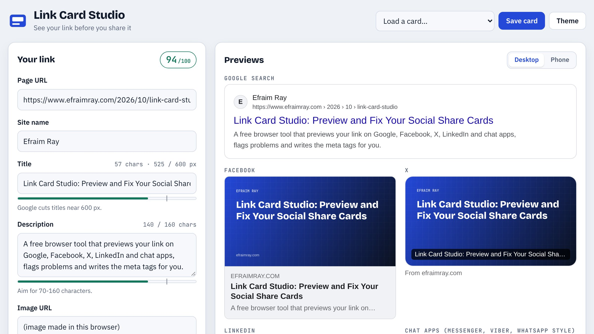
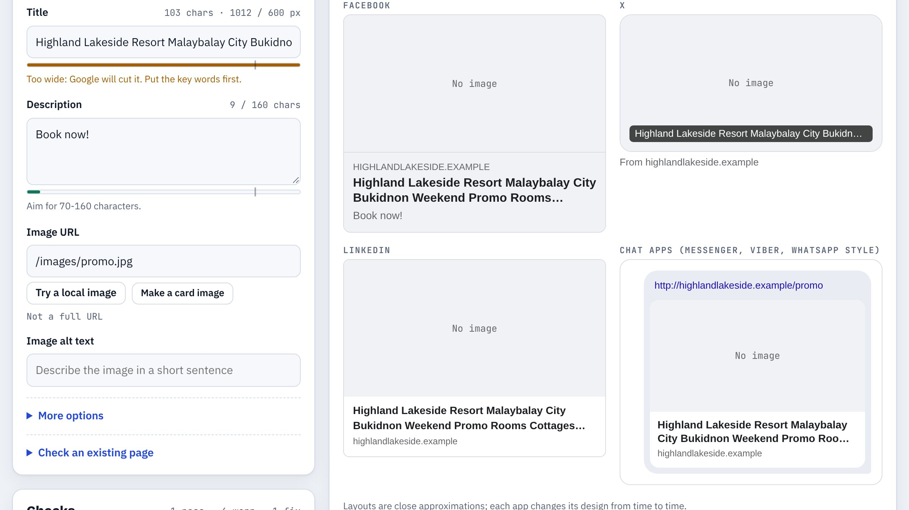
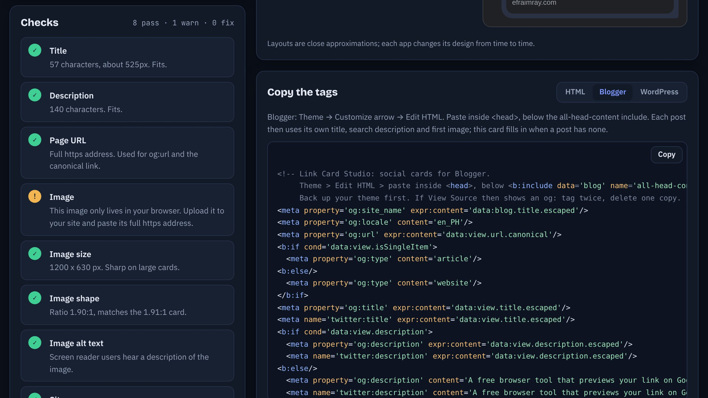
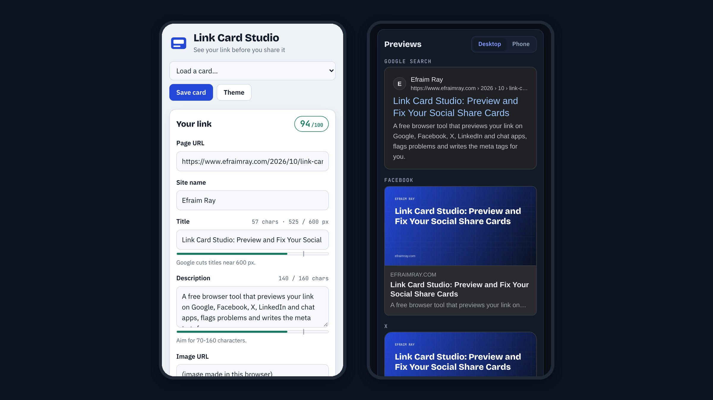

# Link Card Studio

**See your link before you share it.** A free browser tool that previews how a page looks on Google, Facebook, X, LinkedIn and chat apps, checks the title, description and image, and writes the Open Graph and X card tags for plain HTML, Blogger or WordPress.




**Live demo:** https://efraimray.github.io/link-card-studio/

> New here? Read [docs/BUILD-LOG.md](docs/BUILD-LOG.md) for the languages used and how this was built.

## Screenshots


The main screen: the editor on the left, live previews on the right, with the title measured against Google's 600 px limit.


A card that needs work: the title is too wide for Google and the image is a relative path, so every preview shows "No image".


Dark mode with the checks list and the dynamic Blogger theme snippet ready to copy.


The phone layout at 390 px wide, in the light and dark themes.

## Features

- **Five previews** that update as you type: Google search (desktop and phone), Facebook, X, LinkedIn, and a chat-app bubble (Messenger, Viber, WhatsApp style).
- **Pixel ruler** that measures the title in Arial 20px, the font Google uses, so you see when it will be cut at about 600 px.
- **11 checks and a 0-100 score**: title and description length, https URL, absolute image URL, image size (1200 x 630), 1.91:1 shape, alt text, site name, repeated text, X card type.
- **Three outputs** to copy:
  - plain HTML `<head>` tags,
  - a **Blogger theme snippet** that uses each post's own title, search description and first image,
  - a **WordPress mu-plugin** that uses each post's title, excerpt and featured image and steps aside when Yoast SEO or Rank Math is active.
- **Check an existing page**: paste its source to see which tags it has and which are missing.
- **Make a card image**: draws a 1200 x 630 title card in your brand colour.
- **Private**: local images are read with FileReader and never uploaded. Saved cards stay in your browser.
- Light and dark themes, keyboard friendly, works from 360 px wide.

## Tech Stack

| Layer | What |
| --- | --- |
| Markup | HTML5 (one page, semantic landmarks, labelled form) |
| Styling | CSS custom properties, Grid and Flexbox, light/dark tokens |
| Logic | Vanilla JavaScript (ES5 style, no framework, no dependencies) |
| Browser APIs | Canvas 2D `measureText` and `toDataURL`, DOMParser, FileReader, Clipboard, localStorage |
| Tests | Node.js `assert` (core logic) and Playwright (end-to-end) |

No npm install, no bundler, no server code.

## Folder Structure

```
link-card-studio/
├── index.html              The app
├── css/styles.css          Design tokens, layout, preview styles
├── js/core.js              Pure logic: checks, truncation, tag/snippet builders, HTML parsing
├── js/app.js               UI: form, previews, storage, image tools, copy
├── demo/index.html         Single-file build of the app + "About this project" (for sharing)
├── tools/build-demo.js     Builds demo/index.html and counts lines per language
├── tools/about.html        The "About this project" section used by the demo build
├── tests/core.test.js      12 Node tests for js/core.js
├── docs/                   BUILD-LOG, TUTORIAL, DEPLOYMENT, screenshots
├── .github/social-preview.jpg
├── publish-to-github.bat   Double-click on Windows to publish
└── publish-to-github.ps1   The script the .bat runs
```

## Quick Start

1. Download the release zip or clone the repo.
2. Double-click `index.html`. That's it.

Or serve it locally (fonts and the WordPress/Blogger output are the same either way):

```bash
python3 -m http.server 8080
# open http://localhost:8080
```

Run the tests:

```bash
node tests/core.test.js
```

## Usage

1. Pick **Load a card… → Sample: blog post** to see a finished example, or type your own page URL, site name, title and description.
2. Paste your image URL (or use **Try a local image** / **Make a card image** to preview one).
3. Fix anything amber or red in **Checks** until the score is green.
4. Choose **HTML**, **Blogger** or **WordPress** under **Copy the tags** and press **Copy**.
5. After publishing, re-scrape the page in each platform's sharing debugger so it forgets the old card.

To audit a live page: open it, press Ctrl+U, copy everything, then **Check an existing page → Read the tags**.

## Configuration

Limits live at the top of `js/core.js` in `LIMITS` (title 600 px, description 70-160 characters, image 1200 x 630, ratio 1.91). Sample cards live in `SAMPLES` at the top of `js/app.js`. Colours and fonts are CSS custom properties at the top of `css/styles.css`.

## Deployment

- **Easiest (Windows):** double-click `publish-to-github.bat`. It creates the repo, pushes, makes a release and turns on GitHub Pages.
- Any static host works: upload the folder to cPanel `public_html/link-card-studio/`, Netlify, or Cloudflare Pages.

Full steps: [docs/DEPLOYMENT.md](docs/DEPLOYMENT.md).

## Customization

- Rebrand: change `--accent` and the fonts at the top of `css/styles.css`, and the name in `index.html`.
- Add a platform preview: copy one `<article class="pv">` block in `index.html`, style it in `css/styles.css`, and fill it in `render()` in `js/app.js`.
- Add a check: push a new entry in `checkCard()` in `js/core.js` and add a test.

## Roadmap

- Fetch a live URL through a tiny optional proxy (PHP or Cloudflare Worker) instead of pasting source.
- Bulk mode: check every URL in a sitemap.xml.
- More previews: Telegram, Discord, Slack, Pinterest.
- Export the generated card image as JPG with a size picker.

## Contributing

Issues and pull requests are welcome. Keep it dependency-free, run `node tests/core.test.js`, and test at 390 px and 1280 px in both themes.

## Requesting improvements

Open an issue and add the label **`claude-improve`**. The nightly showcase run picks up to two of these, implements them, bumps the version and prepares the update for publishing.

## License

MIT © 2026 Efraim Ray. See [LICENSE](LICENSE).

## Author

**Efraim Ray**, web developer and AI automation specialist in Valencia City, Bukidnon, Philippines.
https://www.efraimray.com/ · https://github.com/EfraimRay

New here? Read [docs/BUILD-LOG.md](docs/BUILD-LOG.md) for the languages used and how this was built.
